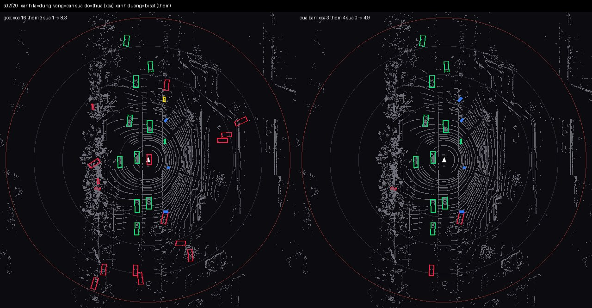

# Báo cáo Day 14 — Đinh Hồng Hải — 03096

- Mã học viên dùng với `--student`: `096`
- `seed_tag` trong `frames_A.txt`: `393590736f`

## 1. Dự đoán trước sweep (bước 5b)

- Tham số tôi nghĩ giảm công sửa nhiều nhất: tăng **`score_thr`** (lên khoảng `0.3`–`0.4`), kết hợp lọc nhẹ **`min_points`** (khoảng `5`).
- Vì sao (nhìn ảnh BEV tập A: box thừa nhiều hay box sót nhiều?):
  - Quan sát 3 ảnh 7-camera và BEV trong `d14_096/png_A/` (`s01f33`: 32 box, `s02f20`: 28 box, `s04f12`: 27 box — tổng 87 box) và kết quả đo cấu hình gốc ở bước 5 (**GT 40, dự đoán 87, khớp 33, xóa 54, thêm 7, sửa 2 → chi phí 24.2**), **box thừa (false positive) chiếm áp đảo** (`54 × 0.3 = 16.2`, chiếm ~67% tổng chi phí sửa).
  - Cụ thể: ở `s01f33` (xóa 23, thêm 1) có rất nhiều box `Car`/`Cyclist` vẽ nhầm lên bụi cây, dải phân cách và hàng xe đạp dựng trên vỉa hè; ở `s02f20` (xóa 16, thêm 3) có nhiều box thừa trên vỉa hè và gần hàng rào; ở `s04f12` (xóa 15, thêm 3) có nhiều box thừa dính vào hàng rào tôn xanh và dải phân cách.
  - Do cấu hình gốc đặt `score_thr = 0.1` và `min_points = 0` quá thấp, các cụm điểm nhiễu từ cây/hàng rào tạo ra rất nhiều box điểm tin cậy thấp hoặc ít điểm LiDAR. Vì vậy tôi dự đoán tăng `score_thr` ở mức vừa phải sẽ loại được lượng lớn box thừa (giảm mạnh phần `0.3 × Xóa`) mà chưa làm sót thêm quá nhiều xe thật (tránh tăng nặng phần `1.0 × Thêm`).

## 2. Tập A: sửa tay và tune

| Cấu hình | Xóa | Thêm | Sửa | Chi phí |
|---|---:|---:|---:|---:|
| Gốc | 54 | 7 | 2 | 24.2 |
| `best_config.json` | 8 | 15 | 0 | 17.4 |

- Tham số đã đổi trong `best_config.json`: `score_thr: 0.1 → 0.5` (giữ `min_points = 0`; ở mức `score_thr = 0.5`, các giá trị `min_points = 0, 5, 10` đều cho cùng chi phí `17.4`).
- Kết quả leave-one-out (dán các dòng `scripts/pp_sweep.py` in ra):
  ```text
  s01f33: cấu hình chọn {'score_thr': '0.5', 'min_points': '0'} → 6.9 (tốt nhất có thể 6.9)
  s02f20: cấu hình chọn {'score_thr': '0.5', 'min_points': '0'} → 4.9 (tốt nhất có thể 4.9)
  s04f12: cấu hình chọn {'score_thr': '0.5', 'min_points': '0'} → 5.6 (tốt nhất có thể 5.2)
  ```
- Cấu hình có ổn định trên từng frame không? Vì sao tôi vẫn chọn (hoặc không chọn) nó:
  - Rất ổn định trên cả 3 lượt leave-one-out: cả 3 lượt đều chọn đúng cùng cấu hình `{'score_thr': '0.5', 'min_points': '0'}`, đạt đúng mức `oracle` trên `s01f33` (`6.9/6.9`) và `s02f20` (`4.9/4.9`), và chỉ chênh `0.4` so với `oracle` trên `s04f12` (`5.6` so với `5.2`).
  - Vì cấu hình này giảm chi phí đồng đều trên cả 3 frame từ 3 sequence khác nhau (`7.9 → 6.9`, `8.3 → 4.9`, `8.0 → 5.6`) và không có dấu hiệu overfit mạnh trên từng frame riêng lẻ, tôi chọn `best_config.json` (`score_thr = 0.5, min_points = 0`) để pre-label cho tập B.

## 3. Trước/sau (bước 8)



- `scripts/pp_compare.py` báo giảm **28%** công sửa trên tập A (tổng chi phí từ `24.2` xuống `17.4`, riêng frame `s02f20` trong ảnh giảm từ `8.3` xuống `4.9`).
- Dự đoán ở mục 1 đúng hay sai? Giải thích bằng số box xóa/thêm/sửa:
  - **Đúng phần chính (vai trò của `score_thr`), nhưng chưa đúng ở mức ngưỡng cụ thể và vai trò của `min_points`:**
    - Tăng `score_thr` từ `0.1` lên `0.5` giúp số box cần **xóa** giảm mạnh từ `54` xuống `8` (giảm `46 × 0.3 = 13.8` chi phí) và số box cần **sửa** giảm từ `2` xuống `0` (giảm `1.0` chi phí).
    - Đánh đổi lại, ngưỡng cao hơn làm số box bị sót cần **thêm** tăng từ `7` lên `15` (tăng `8 × 1.0 = 8.0` chi phí). Tuy nhiên phần giảm nhờ loại bỏ box thừa (`-14.8`) lớn hơn phần tăng do sót box (`+8.0`), nên tổng chi phí vẫn giảm ròng `6.8` (`24.2 → 17.4`, giảm 28%).
    - Thực tế mức tối ưu là `score_thr = 0.5` (cao hơn khoảng `0.3–0.4` mà tôi dự đoán ban đầu), còn `min_points` không giúp giảm thêm chi phí khi `score_thr` đã ở `0.4–0.5` (và ở ngưỡng thấp `0.1–0.3`, `min_points = 5` thậm chí làm tăng nhẹ chi phí vì lọc nhầm một số xe ở xa ít điểm LiDAR).

## 4. Tập B

Số đo từ `scripts/pp_prelabel.py --frames d14_096/frames_B.txt --config d14_096/best_config.json --gt d14_096/ref_B.json`:

| Xóa | Thêm | Sửa | Chi phí |
|---:|---:|---:|---:|
| 46 | 11 | 3 | 26.3 |

- Loại box tốn công sửa nhất ở tập B:
  - **Box thừa cần xóa** đóng góp phần chi phí lớn nhất: `46` box × `0.3` = `13.8` (~52.5% tổng chi phí `26.3`), xuất hiện nhiều ở các frame như `s05f01` (xóa 8), `s02f54` (xóa 7), `s05f34` (xóa 7), `s03f58` (xóa 6) — chủ yếu là các box dự đoán nhầm từ nền/hàng rào/cây cối hoặc `Cyclist` giả dù đã nâng `score_thr = 0.5`.
  - Đứng ngay sau là **box bị sót cần thêm**: tuy chỉ có `11` box nhưng vì trọng số phạt cao (`1.0`/box) nên tốn `11.0` chi phí (~41.8%), tập trung ở các vật thể ở xa, bị che khuất một phần hoặc thuộc lớp có ít mẫu/đặc trưng khác KITTI.
  - **Box cần sửa** rất ít (`3` box × `0.5` = `1.5`, ~5.7%), cho thấy các box đã khớp được với vật thể thật có vị trí và kích thước tương đối tốt.

## 5. Giới hạn

- **Tập tune quá nhỏ (chỉ 3 frame tập A):** Việc chọn tham số trên 3 frame (`40` đối tượng GT) dễ bị phụ thuộc vào bối cảnh riêng của 3 frame đó và khó đại diện cho mọi tuyến đường, mật độ xe hay điều kiện che khuất trong dữ liệu VF.
- **Chênh lệch miền dữ liệu và thiếu lớp đối tượng (KITTI → VF):** Trọng số PointPillars được huấn luyện trên KITTI chỉ có 3 lớp (`Car`, `Cyclist`, `Pedestrian`) với góc nhìn phía trước và phân bố cảm biến khác VF LiDAR 360°; model không học trực tiếp hai lớp `Truck` và `Bus` (chỉ suy diễn hậu xử lý theo ngưỡng kích thước từ `Car`), dễ nhận nhầm xe lớn hoặc tạo nhiều box nhiễu ở hàng rào, bụi cây và vỉa hè.
- **Công thức chi phí chưa phản ánh đầy đủ thời gian thao tác thực tế:** Công thức `0.3·xóa + 1.0·thêm + 0.5·sửa` chỉ là thước đo xấp xỉ trong bán kính `50 m` (ví dụ không phân biệt mức độ khó giữa thêm 1 xe ô tô gần rõ điểm với thêm 1 người đi bộ xa bị che khuất, và cũng không tính các hộp bị ngược đầu 180° do `yaw` xét theo chu kỳ `π`).
- **Không gian tìm kiếm lưới tham số hẹp:** Bước 6 mới quét 2 tham số hậu xử lý toàn cục (`score_thr` và `min_points`) mà chưa tách ngưỡng tin cậy riêng cho từng lớp (`thr_car`, `thr_cyc`, `thr_ped`) hay tinh chỉnh các ngưỡng đổi nhãn `Truck`/`Bus`.
